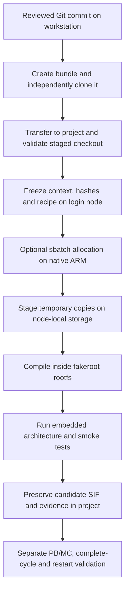

# ARM development: files, functions and simulation cycle

Read this map before changing the ARM build or interpreting its validation.
Commands and acceptance gates are in [BUILD_AND_VALIDATE.md](BUILD_AND_VALIDATE.md).
The build produces a candidate image; the controller later uses that image to
execute a scientific simulation. Keep those two stages distinct in code and logs.

## Build and transfer path

| Project-owned file | Responsibility and caller | Output / next stage |
| --- | --- | --- |
| `container_build/submit_deucalion_arm64.sh` | Local CLI; requires a clean development branch and complete Git history. Checks GROMACS archive, exports source, transfers inputs, prepares context; `--submit` additionally queues it. | Project Git checkout, candidate directory and optional job ID. |
| `container_build/create_source_bundle.sh` | Called before upload. `require_full_history` rejects shallow source; `create_verified_bundle` creates a v2 bundle and checks it from an empty repository and independent clone, including history connectivity and checkout. | Self-contained committed-source bundle. No network or scheduler use. |
| `container_build/prepare_arm64_build.py` | Login-node preparation. `digest` streams SHA-256; `main` validates inputs and creates a new output directory; nested `git` reads provenance; nested `ignore` excludes host ELF/object/archive products and unsafe links. | `context/`, `manifest.sha256`, `build.json`, `source.patch`, rendered `CpHMD.arm64.def`. |
| `container_build/defs/CpHMD.arm64.def.in` | Recipe template rendered by the preparer. `%files` stages inputs, `%post` invokes the compiler script, `%test` invokes the image validator, `%runscript` later invokes the controller. Canonical helper apps are appended from `CpHMD-suite.def`. | Candidate image definition with pinned inputs. |
| `container_build/slurm/build-arm64.slurm` | Reserves selected project account, native ARM CPUs, memory and time. Executes the launcher frozen in this candidate's context. | Native allocation running `run_arm64_build.sh`. |
| `container_build/run_arm64_build.sh` | Host process verifies hashes/allocation, stages temporary copies, and invokes fakeroot. `preserve_exit` copies diagnostics and the true exit status back to the project on success or failure. | SIF, checksum, logs, executed recipe, compiler evidence and build result. |
| `container_build/arm64/build-inside.sh` | `%post` compilation inside the disposable rootfs. Rebuilds helpers/PETIT/PLUMED/GROMACS; retains audited native DelPhi/runtime. `preserve_build_evidence` exports configure/compiler/test records through the host bind mount on exit. | Installed runtime payload and build evidence. |
| `container_build/arm64/check-gromacs-build.sh` | Called after main GROMACS compilation. Explicitly builds the selected test executables (excluded from the normal default target), requires the exact five CTest registrations, and runs those suites. | Test compiler log, selected-suite JSON and fatal-on-failure CTest log. Runs before installation or image smoke checks. |
| `container_build/arm64/validate-arm64.sh` | `%test` native-architecture, shared-library, controller parsing and fixture checks. | Build acceptance only; scientific acceptance remains pending. |
| `container_build/arm64/normalize-runtime-permissions.py` | Image `%post` only. `digest` streams SHA-256; `normalize` clears inherited ACLs/adds public read/traversal within known runtime trees; `main` checks byte identity and records modes/hashes. | Ordinary-user-accessible runtime with unchanged scientific payload bytes. |
| `container_build/arm64/check-unprivileged-runtime.sh` | Host launcher invokes this inside the completed image without fakeroot; requires non-root UID, accessible application/data files, then the native validator. | Separate ordinary-user acceptance log, required before publishing the candidate. |
| `container_build/slurm/repair-arm64-permissions.slurm` | One-off native derivation of the already compiled SIF, followed by ordinary-user runtime tests; no recompilation. | Permission-normalized SIF, parent checksum, byte-identity and runtime evidence. |
| `container_build/slurm/arm64-preflight.slurm` | Optional short infrastructure probe before compilation: inspect native PETIT, build/test fixgro, exercise a minimal fakeroot SIF. | Project-backed probe image/log, without full engine compilation. |
| `container_build/build_x86_64_container.sh` | Separate x86 reference/release builder. `usage` documents CLI; `filesystem_type` and `free_gib` check temporary storage; `hash_runtime_sources` records runtime source consistency around assembly. | x86 reference image/evidence, independent of the ARM launcher. |

The `.slurm` headers describe allocation requests, not simulation parameters.
The Python preparer supports the login node's Python 3.6; image fixtures run
with the Ubuntu bootstrap's newer Python. Do not introduce modern Python syntax
into the login-node preparer without revisiting that compatibility requirement.

Persistent inputs/results belong under
`/projects/F202500250CPCAA2/cphmd-container/arm64-20261026/`.
Only temporary assembly copies use node-local `/tmp`. Fakeroot drops the
supplementary group needed to traverse the project; its input recipe/bootstrap
and output-under-construction must therefore also be staged locally. The host
process retains project access and copies evidence/results back. Preserve failed
work for inspection rather than deleting it during a retry.

## Scientific runtime path

`CpHMD/scripts/CpHMD.sh` is the runtime entry point. Its numbered sections load
explicit settings, choose GROMACS, define filenames, stage inputs, restore state,
and drive cycles. `settings_contract.sh` validates scientific choices before any
PB/MC/MD work and then supplies application-owned paths/policies. It exports no
hidden scientific defaults. Its function comments describe each startup check.

`CpHMD/scripts/functions.sh` is sourced by the controller. Each function's nearby
comment specifies its purpose/arguments and relevant shared state or side
effects. The library shares exported run variables; it is not a standalone CLI.

| Runtime point | Main functions | Role in the cycle / state produced |
| --- | --- | --- |
| Startup | `cphmd_validate_explicit_user_settings`, `cphmd_apply_internal_runtime_configuration` | Require explicit user choices, reject placeholders, set runtime paths/policies. |
| Input/runtime preflight | `cphmd_build_mdrun_command`, `cphmd_preflight_gromacs_runtime`, `check_files`, `make_auxiliary_files`, `cphmd_preflight_mdrun_execution` | Check settings/files and selected engine; exercise zero-step MD before electrostatics. |
| Site/database initialization | `make_sites`, `cphmd_initialize_or_restore_rt_state`, `make_delphi_DB` | Build immutable all-site definitions and run-specific PB database; initialize/restore reduced-titration state. |
| Select PB/MC scope | `cphmd_rt_full_refresh_cycle`, `run_PBMC` | With RT enabled, refresh all sites on cycles `1 + k*RTInterval`; otherwise sample the active subset. Without RT, sample all sites. |
| Materialize complete protonation state | `cphmd_refresh_reduced_titration_state`, `cphmd_merge_reduced_titration_cycle`, `cphmd_materialize_fixed_rt_cycle`, `cphmd_materialize_nonrt_cycle` | Preserve full templates, merge active results with fixed sites, or materialize a cycle with no active sites. Atom/site order must remain stable. |
| Apply state and integrate | `update_topology`, `run_relaxation`, `run_dynamics` | Apply current protonation, relax when applicable, then advance effective MD using GROMACS and optional PLUMED. |
| Retain/continue | `data_append`, `cphmd_write_checkpoint`, `cphmd_finalize_segment` | Validate/append outputs and finalize a restartable segment. A checkpoint is resumable only after `FINALIZED=1`. |
| Diagnose failure | `cphmd_preserve_failure_diagnostics`, `cphmd_pbmc_error`, `cphmd_output_error` | Preserve failed-cycle evidence. PB/MC errors use exit 43; invalid MD/output state uses 42. |

Within `run_PBMC`, coordinate preparation precedes electrostatics and Monte
Carlo. `CpHMD/src/fixgro.c` supplies the optional non-membrane multi-solute/ITP
periodic assembly path; its native executable is installed at
`/CpHMD/scripts/fixgro`. Its file header explains Cartesian/fractional coordinates,
shared 1-based arrays and the function call order; each function has a brief
purpose comment. DelPhi utilities prepare electrostatics inputs/results, the
native solver supplies PB energies, and PETIT samples protonation states.

`DelphiTools/src/PROVENANCE.json` pins recovered PB-helper source provenance.
`petit1.6.1/` and `plumed/` contain upstream numerical code: preserve their
provenance, and explain integration in wrappers/docs instead of adding unrelated
comment churn throughout vendored sources. The retained DelPhi/NVHPC binaries
also require recorded provenance and scientific comparison.

## Validation files

| File | What it proves / how it is called |
| --- | --- |
| `tests/check_source_bundle.sh` | Offline regression: a depth-one source is refused before packing; a complete bundle restores all fixture commits and file contents into a recipient. Called by host support checks. |
| `tests/check_arm64_build_support.sh` | CI/workstation shell parsing, transfer regression, helper compilation and fixgro/PETIT fixtures; does not prove native ARM image correctness. |
| `tests/check_gromacs_test_gate.sh` | Real CMake fixture reproducing tests excluded from the default target; checks that our gate builds/runs all five suites and rejects a deliberate test failure or missing registration. Requires CMake/CTest; CI runs it separately. |
| `tests/arm64/check_fixgro.py` | `main` creates flat/nested periodic assembly fixtures; `coordinates` runs the helper and validates compactness, centering and atom order. Optional reference comparison uses GRO precision. |
| `tests/arm64/check_petit.py` | `main` chooses pH -1, 0, 1; `check_ph` runs a seeded two-state MC model, checks output shape/finite normalized probabilities and analytic occupancy within a sampling tolerance. |
| `tests/arm64/md_smoke.sh` | Runs `grompp`, short CPU `mdrun` with PLUMED, trajectory/energy readers and a finite COLVAR check in a disposable test directory. |
| `tests/arm64/water.mdp` | Seeded 20-step NVE/PME engine fixture with several output frames. |
| `tests/arm64/water.top` | 216-SPC-water topology matching installed `spc216.gro`; standard OPLS/SPC includes isolate the engine from CpHMD force-field edits. |
| `tests/arm64/water.plumed.dat` | Unbiased distance output every five steps, exercising PLUMED loading and numeric output. |

Complete image smoke checks still do not establish fixed-coordinate PB/MC
agreement, RT reconstruction, restart continuity or end-to-end throughput.
Those are the subsequent gates in the build/validation guide.

The agreed HEWL scientific test campaign is described in
[HEWL_4LZT_VALIDATION.md](HEWL_4LZT_VALIDATION.md). Its first-stage script,
`tests/arm64/prepare_hewl_structure.py`, pins and cleans the deposited structure
before CpHMD residue mapping/topology generation: `residue_key` preserves chain
and insertion identity, `atom_signature` compares coordinates to old inputs,
`clean_protein` resolves residue alternates and checks completeness, and `main`
writes a new PDB plus provenance audit. `tests/check_hewl_structure.sh` exercises
the real pinned fixture, alternate selection, S–S geometry and failure guards.
This preprocessing happens before any PB/MC/MD cycle or scheduler submission.

The actual topology results are in
[HEWL_TOPOLOGY_2026-10-27.md](HEWL_TOPOLOGY_2026-10-27.md). HEWL menu/terminal
construction helpers remain provisional fixture tooling; general fixes and CI
adoption are deferred in [DEFERRED_ISSUES.md](DEFERRED_ISSUES.md). The ARM image
permission fix is an immediate delivery gate, separate from that deferred work.

The next solution stage is documented in
[HEWL_SOLUTION_2026-10-27.md](HEWL_SOLUTION_2026-10-27.md). It maps the new
`prepare_hewl_solution.sh`, ion planner, health/snapshot checker, explicit MDPs
and native SLURM wrapper to their callers and pass criteria. These scripts
prepare a frozen input for PB/MC; they do not invoke the CpHMD controller.

## Commenting and maintenance convention

For each new or changed project-owned file, keep a short header explaining its
purpose, caller, inputs/outputs and place in the build or simulation cycle. For
functions, document purpose, arguments, important shared state/side effects and
failure behavior. Add inline comments for numerical choices, indexing, state
invariants, staging constraints and preservation decisions. Explain why a step
exists rather than narrating each command. Update this map when adding a stage.

Keep behavioral changes separate from explanatory comments in review. Do not
infer scientific equivalence from a compile or smoke-test result; record the
fixture, seed, tolerance, source commit and image hash for scientific comparisons.
