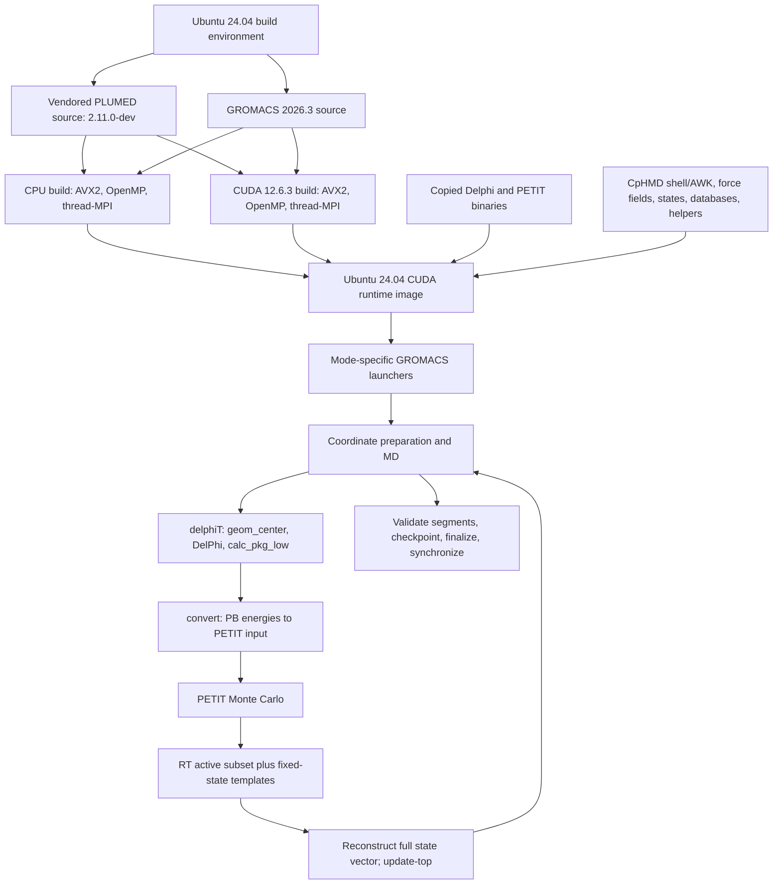

# ARM sprint assessment — 26 October 2026

Target: a scientifically validated GROMACS 2026.3 ARM implementation by 27 October, followed by additional performance and reproducibility work before ARM access ends. This is an engineering assessment, not a claim that ARM scientific validation has passed.

## Repository and preserved development state

- Active isolated checkout: `/home/jsequeira/Documents/ChatGPT/CpHMD Container — ARM64 & Publication/CpHMD-container`.
- Development branch: `codex/arm64-deucalion-20261026`, based on upstream `main`, commit `9c83d8e7dcd043463d34553acdb91666e06a5593` (28 July 2026).
- `origin`: `https://github.com/jgnseq/CpHMD-container.git`; `upstream`: `https://github.com/mms-fcul/CpHMD-container.git`.
- The personal fork exposes `main` at `73604c5` and `arm64-deucalion` at `1553bad`; these predate the current release runtime. Do not base the new runtime on either without incorporating the release changes.
- Upstream ARM branches are `dev/aarch64-port` at `2243fd0` and `optimize-gromacs-a64fx-sve` at `737a046`. These contain the recovered ARM source/runtime payload and phase-6 recipe.
- The handover's development repository is accessible through the mounted path `/home/jsequeira/mini05/Projects/side/06_CpHMD-container/02_CpH-reduced-ASICs/CpHMD-container`. Its checked-out branch is `release/0.7.0-preparation`, HEAD `e503519`, with substantial tracked and untracked changes relative to that old HEAD. Its settings, `functions.sh`, and canonical recipe match upstream `main` byte-for-byte; the main driver has a one-character comment whitespace difference. It must not be reset or cleaned.
- The production helper is accessible through the corresponding `/home/jsequeira/mini05/Projects/04_ASICs/...` mount. It is campaign-specific and sources campaign configuration/common helpers. It was inspected, not executed or changed.
- No commits, pushes, production changes, or deletion of results were performed. The only development additions in this branch are this assessment and its evidence records.

## Build and runtime architecture



The canonical release recipe is `container_build/CpHMD-suite.def`; the wrapper is `container_build/build_x86_64_container.sh`. GROMACS uses mixed precision, external MPI disabled, thread-MPI and OpenMP enabled, FFTW built with GROMACS, and native PLUMED integration. Launchers isolate CPU/CUDA `libgromacs` paths because both libraries have the same SONAME. This separation must be preserved.

`tests/gpu-output-contract/` contains builders, SLURM generation, integration/restart harnesses, an independent RT auditor, and performance parsing. Generic scheduling support is under `template/slurm/`; the external ASIC campaign helper should not be used as a universal Deucalion launcher.

## Dependency and portability inventory

| Component | Current state | ARM action |
|---|---|---|
| Ubuntu 24.04; Bash, GNU AWK, bc, Python, Perl, gzip, rsync | Portable packages, with GNU-specific script requirements | Install native packages; retain executable interpreters and utility behavior |
| GROMACS 2026.3 | Current release fixes SIMD to `AVX2_256`; uses CUDA builder/runtime images | Native CPU-only build; explicit `ARM_SVE`, length 512, on the confirmed A64FX; expose a separate NEON fallback configuration |
| FFTW | Current release builds its own; old ARM image reports FFTW 3.3.10 NEON | Record actual library/configuration; measure before introducing alternative FFT libraries |
| PLUMED | Vendored 2.11.0-dev; tracked x86 objects and shared libraries exist | Build from a clean source copy in the container; verify no x86 objects survive. Preserve PLUMED behavior if enabled |
| PETIT 1.6.1 | Source is present; shipped executable resolves to x86 code | Compile `petit.c` natively with libm; conservative floating-point flags; run `sample.dat` plus an analytic small-state test |
| DelPhi solver | Release has legacy x86 `delphi_pgf90`; matching ARM branch contains Fortran source and ARM executable | Recover exact source/build provenance; rebuild or use the recorded ARM payload initially; test solver output numerically |
| `geom_center`, `calc_pkg_low`, `my_mem` | ARM branch and Deucalion build area contain C sources and native binaries | Rebuild natively; compare centers, pK values and interaction matrices against x86 fixtures. Check source limits and the historical large-system fix |
| NVHPC runtime | Old ARM image resolves six libraries under `/opt/nvhpc/lib` | Preserve exact versions, hashes and redistribution notices; avoid introducing host runtime dependencies |
| `fixgro` | x86 executable in release and old ARM image; duplicate under AMBER force-field scripts | Locate source and rebuild. Until then the optional non-membrane multiple-solute/external-ITP paths are not ARM validated |
| `update-top`, `make_sites`, PB/MC AWK helpers | Text scripts | Verify site order, terminal sites, indices, full-state reconstruction and topology updates |
| Force fields, state templates, charge/radius databases | Text/data, with some legacy executable baggage inside force-field directories | Preserve data hashes; audit the full final payload, not just executable PATH entries |
| Legacy ARM scaffold | `CpHMD.aarch64.def` references absent `compile-files` paths in current main; omits MD/MC engines | Replace the build path for current runtime; do not treat the scaffold as a functioning ARM implementation |

The source-available components do not yet establish that no source changes are needed. Particular risks are legacy Fortran pointer/kind assumptions, helper array limits, and matching the amended x86 electrostatics implementation. A new solver or altered physical model is outside this port's scope.

Native building is the shortest validated route. Cross compilation is possible in principle, and Deucalion documents Fujitsu cross compilers, but configuring dependencies and executing checks across architectures adds work to this sprint. Pulling an ARM base image on x86 does not translate embedded x86 executables.

A NEON fallback must also rebuild its dependencies without A64FX/SVE-only compiler flags; changing `GMX_SIMD` alone does not establish a portable binary. The new image should reject any remaining x86 ELF in its payload, including stale objects and optional helpers.

The broader fixgro filename search covered mini05's `Projects`, `programs`, `Downloads`, `Documents`, `tools`, and `CpHMD-backups`, the accessible Deucalion home tree, and local project/download/program folders. It found executable copies, instruction-generation scripts and `.fixgro` inputs, but no `fixgro.c`. The small matching archive `Joao-Tests-CpHMD.zip` was inspected by member names and contains `.fixgro` inputs, not C/C++ source. This is not proof that source is absent from other hosts or differently named archives. A likely source directory/archive/host would help; the supported single-solute and membrane test paths can proceed independently.

## Actual Deucalion observations

Environment probe job `2146352` completed on `cna0001` with exit `0:0`, using account `f202500250cpcaa2a`. SLURM charged an allocation of 48 CPUs; the probe step requested two. The allocation elapsed 11 seconds.

- CPU: Fujitsu A64FX, 48 cores, one thread per core, four NUMA domains of 12 cores each.
- ISA flags include ASIMD and SVE. `/proc/sys/abi/sve_default_vector_length` is 64 bytes, i.e. 512 bits.
- Compute OS: Rocky Linux 8.5; kernel `4.18.0-348.23.1.el8_5.aarch64`.
- Runtime: Singularity CE `4.3.2-1.el8`. Apptainer was not on the login PATH.
- Default host GCC/gfortran: 8.5.0; the container's compiler is independent of that host default.
- Compute-node module paths select ARM software. Login module paths select x86 software and must not be used to infer ARM compiler availability.
- User-namespace limit: 32104 on the ARM node, zero on the login node. An actual new fakeroot recipe build is still required.
- Compute local root filesystem had about 418 GiB free. Home is NFS; `/projects` is Lustre. Global free space is not project/user quota.
- User home quota observed from the login node: 20 GiB soft, 25 GiB hard, and 20000/25000 files. A previous NVHPC sandbox pull explicitly failed with `disk quota exceeded`.
- The guessed project paths `/projects/f202500250cpcaa2` and `/projects/f202500250cpcaa2a` do not exist. Discover the actual writable project directory before choosing persistent build storage. Use node-local temporary/cache directories for builds.
- The live ARM partition reports no GPU resource. GPU mode is not a target for this A64FX image.

The existing `/home/jsequeira/container-builds/final-images/CpHMD-aarch64-phase6-sve512.sif` was inspected on ARM. Its SIF filesystem is arm64. GROMACS 2024.3 runs, reports ARM_SVE, mixed precision, thread-MPI, OpenMP, and FFTW 3.3.10 NEON. PETIT reports 1.6.1. The three Delphi computation binaries are AArch64 and all listed solver shared libraries resolve. However, `/CpHMD/scripts/fixgro` is still x86-64. These observations do not demonstrate an end-to-end scientific ARM calculation, and the image is not the required 2026.3 runtime.

## What has actually passed

On the clean upstream-main-based checkout:

| Check | Result |
|---|---|
| `bash tests/static_checks.sh` | PASS; advisory ShellCheck unavailable |
| `bash tests/check_databases.sh` | PASS |
| `bash tests/check_reduced_titration_logic.sh` | PASS, including refresh scheduling behavior |
| `bash tests/check_asic_settings.sh` | PASS |
| Independent RT audit of stored CPU cycles 1–7 | PASS; latest full refresh 6, 39 active sites |
| Independent RT audit of stored GPU restart cycles 13–15 | PASS; restores cycle-11 selection, 38 active sites |

The saved GPU initial checkpoint records 12 cycles and latest full refresh 11. The saved restart checkpoint records 15 cycles and still latest full refresh 11. Historical validation logs contain readable XTC/EDR checks for CPU time 0–140 ps and resumed GPU time 240–300 ps. Those are historical x86 checks, not new ARM validation or fresh GROMACS checks of the binary outputs.

The RT auditor already supports `--from-cycle`, treats absent historical debug sections as context, and has no strict-history compatibility mode. No audit simplification is needed. A legacy test in the old mounted preparation checkout fails because it expects obsolete call patterns; the corresponding released test passes. This does not establish a runtime regression.

The runtime implements the short `PBMC` basename, explicit exit 43 handling, immutable all-site definitions, full-length fixed templates, empty active-set handling, checkpoint metadata, restored RT state, topology updates, validated/finalized segments, and scheduler continuation. ARM execution, numerical equivalence, throughput, optional PLUMED execution and optional fixgro paths remain unverified for the new implementation.

## Sprint execution order

| Priority | When | Work and completion gate |
|---|---|---|
| P0 | 26 October evening | Freeze source identities; recover ARM source payload selectively from `737a046`; preserve current runtime; locate fixgro source; record build storage and toolchain capabilities |
| P0 | Immediately afterward | Native CPU-only GROMACS 2026.3 build, clean PLUMED build, native PETIT/helpers, Delphi runtime integration. Cap build parallelism to the node's memory and allocation; do not use unrestricted `nproc` automatically |
| P0 | Before larger simulation | Verify every ELF/shared library in the final image, loader resolution, GROMACS version/SIMD, targeted official GROMACS regression tests, PETIT sample/analytic case, fixed-coordinate PB/MC fixture and complete-state/topology reconstruction |
| P0 | 27 October | Short MD and CpHMD runs: RT disabled, then RT interval 5 through cycle 7; restart after a finalized reduced cycle; confirm refreshes at 1 and 6, no forced refresh on continuation, fixed templates, final GRO/TOP/TPR, XTC/EDR readability and time continuity |
| P0 | 27 October | Initial A64FX performance sanity check and affinity/thread configuration on a representative input; retain a working configuration only if scientific gates pass |
| P1 | Remaining access window | Compare SVE-512 and NEON builds; tune thread-MPI/OpenMP splits within one node, 12-core NUMA locality, and thread affinity. Measure MD and PB/MC separately and end-to-end; repeat representative cases |
| P1 | Before access ends | Matched x86 CPU comparison, independent-seed sampling, larger/representative membrane case, build-repeatability check, archived sources/SIF/checksums/logs/inputs/results and verified off-cluster copies |
| P2 | After machine-dependent work | Refactor duplicate paths, consolidate test harnesses, broader platform/MPI support, documentation polishing, diagrams, manuscript and release cleanup |

Use `dev-arm` for compilation/build preparation and `normal-arm` for simulations/benchmarks, following site policy. External MPI/multi-node tuning is secondary: the current runtime uses thread-MPI and Delphi distributes sites across same-host processes. Do not change the architecture and the scientific workflow simultaneously.

The highest-risk gate is electrostatic agreement of the recovered Delphi/helper implementation with the current x86 implementation. If that fails, pause performance claims and identify source/precision/solver differences first. Do not spend this window on the unrelated production exit-43 incident unless the same defect appears in ARM validation.

## Validation contract to freeze before comparing results

1. Structural invariants are exact: site identities/order/counts, atom/topology indexing, legal protonation states, vector lengths, fixed-template values, active/template correspondence, refresh schedule, checkpoint cycle metadata, and increasing non-overlapping segment time coverage. Shared boundary frames may occur in separate segments and must be handled deliberately.
2. Compare fixed coordinates and identical 2026.3 settings before divergent trajectories. Proposed initial engineering gates: normalized force RMS difference at most `1e-4`; absolute potential-energy difference per atom at most `1e-3 kJ/mol`; per-site intrinsic pKa difference at most `0.01`; converted interaction free-energy differences at most `0.01 kBT` after explicitly establishing the file units/conversion. These are proposed gates, not measured results or universal physical tolerances. Freeze them after checking same-architecture repeatability and solver precision, before inspecting the ARM comparison. Record and explain any revision.
3. Use an exactly enumerable one/few-site PETIT fixture to check equilibrium probabilities and parser behavior. Record random seeds and sampling lengths. Do not require identical MC state sequences across architectures.
4. For live RT runs, thresholds near a selection boundary can produce different active subsets. Compare deterministic selection fixtures exactly; assess stochastic occupancies with autocorrelation-aware blocks and independent seeds. For publication-level equivalence, propose a 95% confidence interval for a per-site mean-protonation difference wholly within ±0.02; treat insufficient effective samples as inconclusive, not a pass. A short smoke run alone cannot meet this statistical claim.
5. Benchmark fixed inputs, physics, precision, output cadence and work per cycle. Include warm-up, at least three repeats for representative configurations, median and spread, actual core allocation, memory usage, affinity, and both MD-only ns/day and complete CpHMD cycle/simulation throughput. Do not infer container overhead without a matched native run.

## Evidence to preserve while ARM is available

- Exact repository commit plus any patch, untracked source manifest, source archive hashes, OCI image digests, resolved package versions, PLUMED identity, compiler versions/flags, CMake cache and FFTW configuration.
- Hardware/OS/SVE/NUMA information, actual module/compiler/MPI identities if used, Singularity version, SLURM script/job ID/account/allocation, affinity and local-storage settings.
- Complete build stdout/stderr, all ELF/loader/dependency audits, functional/PB/MC comparison inputs and outputs, tolerances, seeds, successful and failed validation logs, timing and memory measurements.
- Final SIF and SHA-256, definition and build wrapper, checksummed test inputs, segments/checkpoints/restart vectors, RT audit output, benchmark raw data and analysis commands. Preserve old images/results separately and verify copied hashes off Deucalion.
- Publication matrix distinguishing release x86 CPU/CUDA evidence, old 2024.3 ARM executable checks, and new 2026.3 ARM scientific/performance evidence. Preserve claims only when supported by those records.
- License/source/citation inventory: repository GPLv3, PETIT and relevant meadTools headers GPLv2-or-later, exact GROMACS/FFTW/PLUMED terms, and provenance/permissions for the specific legacy DelPhi/helper sources. Confirm the exact NVHPC runtime's redistributable-file list and accompanying notices before public redistribution. Finding a binary in Git is not a license determination.

## Git commands for this completed inspection step

The isolated clone and development branch already exist; do not repeat the clone over the existing folder.

```bash
cd '/home/jsequeira/Documents/ChatGPT/CpHMD Container — ARM64 & Publication/CpHMD-container'
git status --short --branch
git remote -v
git log -1 --format=fuller
git diff --check
git diff --stat upstream/main
git ls-files --others --exclude-standard
```

After inspecting this assessment and evidence, the commands to record this step are:

```bash
cd '/home/jsequeira/Documents/ChatGPT/CpHMD Container — ARM64 & Publication/CpHMD-container'
git add -- docs/aarch64/SPRINT_2026-10-26.md docs/aarch64/evidence/2026-10-26
git diff --cached --check
git diff --cached --stat
git diff --cached -- docs/aarch64/SPRINT_2026-10-26.md
git commit -m 'Record Deucalion ARM audit and validation plan'
git push --set-upstream origin codex/arm64-deucalion-20261026
```

These commit/push commands are provided for the user; they have not been executed. The inspection clone was fetched with depth 20; deepen the relevant remote history before any ancestry-sensitive merge/rebase, if needed. Future implementation steps should stage explicit paths and include their targeted validation before commit/push commands are supplied.

For a new clone on another machine, use an unused directory and establish the same base explicitly:

```bash
git clone --origin origin https://github.com/jgnseq/CpHMD-container.git CpHMD-container-arm-sprint
cd CpHMD-container-arm-sprint
git remote add upstream https://github.com/mms-fcul/CpHMD-container.git
git fetch upstream main optimize-gromacs-a64fx-sve dev/aarch64-port
git switch --create codex/arm64-deucalion-20261026 --no-track 9c83d8e7dcd043463d34553acdb91666e06a5593
git status --short --branch
```

## First machine commands for implementation

The following allocation consumes account resources; use it for compilation. The five-minute discovery allocation has already completed.

```bash
ssh deucalion
salloc --account=f202500250cpcaa2a --partition=dev-arm --nodes=1 --ntasks=1 --cpus-per-task=8 --time=04:00:00
hostname
uname -m
lscpu
free -h
cat /proc/sys/abi/sve_default_vector_length
module -t list
module -t avail GCC OpenMPI FFTW CMake NVHPC FJSVstclanga
singularity --version
unshare -Ur true
df -h /tmp
findmnt -T /tmp
```

Confirm the shell is on the allocated ARM node before building; use a job step if the site's allocation command does not enter it. The next implementation step must provide the concrete recipe and build command, with an unused output path and node-local temporary/cache storage. No functioning 2026.3 ARM recipe has been created in this inspection step.

References: [Deucalion compilation policy](https://docs.deucalion.acnca.pt/compilation/), [GROMACS 2026.3 installation guide](https://manual.gromacs.org/2026.3/install-guide/index.html), [NVIDIA HPC SDK license](https://docs.nvidia.com/hpc-sdk/eula/index.html). Verify license terms against the exact archived runtime version, not only the current web page.
